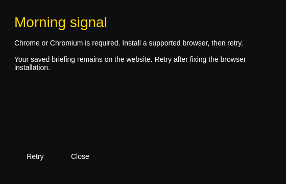

Native browser recovery window, rendered offscreen with a missing-browser test fixture. The main briefing opens in Chrome; this image does not show a signed-in briefing.

# Morning signal for the desktop

Morning signal opens the [live daily briefing](https://bartconsedine.com/admin/apps/morning-feed) in its own Chrome app window, with a launcher icon and optional display mode. This is a desktop entry point to the existing app: editing, saved ritual completions, TLDR read progress, Calendar and commands use exactly the same deployed web code and permissions.

## Build and install on Omarchy / Arch

```sh
cd desktop/morning-signal
bin/build
bin/test
bin/install
morning-signal
```

The installer builds an Arch package and installs its binary, icon and desktop entry through `makepkg -fsi`. Open **Morning signal** from the app launcher (`Super + Space`). Its desktop actions also offer **Open display** and **Open in browser / Sign in**. Removing the `morning-signal` package removes the launcher; it does not delete saved app data or browser sessions.

Requires `qt6-base`, `qt6-declarative`, `qt6-wayland`, a C++ compiler, `qmake6`, `make`, and Chrome or Chromium. Chrome is preferred, then Chromium; the regular profile selected by that browser is used. If another browser/profile holds your signed-in session, sign in with the intended account in the selected browser. No profile is copied, changed, or inspected by this launcher.

For a user-only installation without a system password, run `bin/install-user` instead. It installs the tested binary under `~/.local/bin` and the desktop entry, icon and license under `${XDG_DATA_HOME:-~/.local/share}`. The desktop entry uses an absolute executable path. To uninstall that version, remove those four `morning-signal` files; no browser or Supabase data is removed. The Arch package remains available through `bin/install` for managed system installation.

Chrome includes its active profile in the window class. If it uses a non-default profile, inspect the new app window with `hyprctl -j clients` and reinstall with `MORNING_SIGNAL_WM_CLASS='<observed class>' bin/install-user` to match the launcher icon to that window. This only changes launcher metadata and does not select or read a browser profile.

## Same backend and sign-in

The native C++ launcher hands a fixed HTTPS production URL to Chrome using `QProcess` argument arrays, then exits. There is no resident native daemon, webview, bundled server, injected JavaScript or parallel database client. Chrome owns rendering, network errors, authentication and unsaved-edit prompts. A missing or unlaunchable browser produces a themed Qt Quick error window with Retry and Close.

This deliberately uses a full browser because the app signs in through Google; [Google prohibits OAuth in embedded user agents](https://developers.google.com/identity/protocols/oauth2/policies#use-secure-browsers). The launcher ships no API keys, tokens or database credentials. Sign-in uses the existing site's auth redirects, cookies, verified identity and owner-scoped authorization. **Open in browser / Sign in** provides the ordinary browser interface when needed; afterward reopen the desktop app in the same browser/profile.

All durable records remain in the existing Supabase backend: `morning-feed` / `screen-v1` for the briefing and the existing TLDR progress records. Saves require the web app's Save action and confirmed server response. Stale revisions, failed saves and access denials retain their current web behavior. [The web app README](../../src/private-apps/morning-feed/README.md) defines the data and ownership contract; [chat maintenance](../../docs/CHAT_APP_DATA.md) continues to edit the same records.

The editor loads current records when opened or reloaded. Display mode refreshes saved briefing cards every 30 seconds; source/read-progress refreshes follow the existing web app. This is not a new real-time subscription. Save edits before reloading or changing modes. Offline operation shows the browser/web app's network or stale-data state; there is no offline write queue. Website releases are available on reload without rebuilding the launcher.

## Commands and shortcuts

| Command | Effect |
| --- | --- |
| `morning-signal` or `morning-signal open` | Open the editor in a dedicated app window |
| `morning-signal display` | Open Home, News, Briefing, Calendar and Commands in display mode |
| `morning-signal browser` | Open the editor in a normal browser tab, including sign-in |
| `morning-signal check --json` | Check local browser availability, without opening a window or testing authentication |
| `morning-signal --help` | Show command usage |

| In the briefing window | Action |
| --- | --- |
| Ctrl+R | Reload current saved state (save or preserve unsaved edits first) |
| F11 | Toggle full screen |
| Tab / Shift+Tab | Move between controls |
| Arrows / Enter / Back | Existing display navigation and selection |
| In the native error window: Space / Q / ? | Retry / close / show shortcuts |

The web interface retains its own language and appearance. The native error window follows Omarchy's accent, rounding and language live, with English fallback and a Danish catalog. It does not change desktop preferences.

## Verification

`bin/test` checks fixed URL/mode selection, browser priority and absence, detached launch arguments, launch failures, translation fallback/change, and loading the actual QML failure window. Tests use temporary executable fixtures and never sign in or mutate live data. `check --json` reports browser discovery only, not successful authentication, page rendering, or Supabase access.

On November 13, 2026, the native build and eight Qt test cases passed on Omarchy with Qt 6.12.0. The user-level installation opened the actual production URL in a dedicated Chrome window and reached Google's account chooser. Live signed-out desktop (1440×900) and mobile (390×844) website checks had no horizontal overflow. An approved signed-in owner session was unavailable, so live saved-state reload, cross-device synchronization and second-user denial remain unverified in this desktop delivery. No hosted database, OAuth settings or membership changes were made.

For live verification: open the installed launcher, sign in if needed, save an intended edit, reload, then confirm it in a normal browser session. Display mode should see a browser-saved edit on its next refresh. An unauthorized session must still be denied by the existing protected APIs. Do not mistake a successful browser handoff or a login screenshot for verified persistence.
